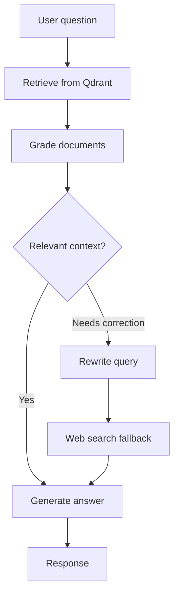

<div align="center">

# Advanced Agentic RAG System

### Adaptive Retrieval · Document Grading · Corrective Workflows

**A LangGraph-powered retrieval-augmented generation application with Qdrant hybrid search and a Streamlit interface.**


[Architecture](#architecture) · [Features](#features) · [Quick Start](#quick-start) · [Project Structure](#project-structure)

</div>

---

## Overview

This repository contains a **Corrective Retrieval-Augmented Generation (CRAG)** application built around a LangGraph state graph. It retrieves context from Qdrant, grades document relevance, and routes the query toward response generation or a correction-and-search fallback path.

The codebase provides both a **Streamlit interface** and a **command-line entry point**, together with separate modules for retrieval, grading, generation, and query transformation.

> **Project status:** Source code and example configuration are provided. No benchmark, production deployment, or performance validation is claimed here.

## Features

- **Stateful LangGraph workflow:** explicit graph nodes and conditional routing for retrieval, grading, correction, and generation.
- **Hybrid retrieval:** Qdrant dense and sparse vector search, with reciprocal rank fusion (RRF) support.
- **Document relevance grading:** evaluate retrieved context before using it to generate an answer.
- **Corrective RAG path:** transform a weak query and use a web-search fallback where configured.
- **Configurable reranking:** components for post-retrieval ranking and cross-encoder integration.
- **Conversation state:** in-memory checkpointer by default; PostgreSQL-related configuration is present in the codebase.
- **Two entry points:** Streamlit app (`app.py`) and terminal query runner (`main.py`).
- **Tests:** included tests cover state behavior and reciprocal rank fusion.

## Architecture



**Retrieval path:** Dense embeddings and sparse representations are combined with reciprocal rank fusion. The graph handles low-quality retrieval by routing through query transformation and optional web search.

## Technology Stack

| Layer | Technologies |
| --- | --- |
| Language | Python |
| Orchestration | LangGraph, LangChain |
| LLM and embeddings | OpenAI integration |
| Vector search | Qdrant (dense + sparse retrieval) |
| Ranking | Reciprocal Rank Fusion, configurable reranking |
| Interface | Streamlit |
| Optional search fallback | Tavily |
| Persistence | In-memory checkpointing; PostgreSQL configuration |
| Tests and linting | pytest, Ruff |

## Project Structure

```text
.
├── app.py                 # Streamlit UI
├── main.py                # Command-line entry point
├── requirements.txt       # Python dependencies
├── src/
│   ├── chains/            # LLM, grading, rewriting, generation
│   ├── config/            # Application settings
│   ├── graph/             # Graph assembly and routing
│   ├── nodes/             # Retrieval and processing nodes
│   ├── retrieval/         # Qdrant, RRF, sparse encoder, reranker
│   └── state/             # Graph state schema
└── tests/                 # State and fusion tests
```

## Quick Start

### 1. Clone the repository

```bash
git clone https://github.com/mosanalee231/advanced-agentic-rag-system.git
cd advanced-agentic-rag-system
```

### 2. Create an environment and install dependencies

```bash
python -m venv .venv
```

Activate the environment (Windows PowerShell):

```powershell
.venv\Scripts\Activate.ps1
```

Then install dependencies:

```bash
pip install -r requirements.txt
```

### 3. Configure credentials and services

Copy the provided `.env.example` to `.env`, then supply your own settings. For example:

```env
OPENAI_API_KEY=your_openai_api_key
QDRANT_URL=http://localhost:6333
QDRANT_COLLECTION_NAME=enterprise_rag
```

Start or connect to a Qdrant instance before running retrieval. Optional integrations may require additional environment variables, such as `TAVILY_API_KEY` for real web search. Check `src/config/settings.py` for the supported settings and model defaults.

**Security:** Never commit `.env`, real API keys, tokens, or credentials.

### 4. Launch the app

```bash
streamlit run app.py
```

Or try the command-line entry point:

```bash
python main.py --query "What is retrieval-augmented generation?"
```

> The app requires working model credentials, a reachable Qdrant service, and indexed data for meaningful retrieval results. Running commands has **not** been independently validated as part of this README preparation.

## Testing

```bash
pytest
```

## Screenshots and Demo

Add real screenshots of the running Streamlit application and an example query only after testing it. Avoid mock results presented as actual outputs.

## Roadmap

- [ ] Validate complete setup on a fresh environment
- [ ] Add reproducible sample data and an indexing walkthrough
- [ ] Capture authentic application screenshots
- [ ] Add end-to-end integration tests
- [ ] Document deployment and operational requirements

## Source Attribution and License

> **Attribution required:** This repository was prepared from an existing `agentic-rag-main` project archive. Before publishing this README as final documentation, identify and link the original source repository and preserve its copyright and license terms. Do not represent unmodified third-party code as original implementation.
>
> **Original source:** _Add verified original GitHub URL here._
>
> **Modifications:** _Describe only changes you actually made._

If the source has no identifiable license, that does not automatically grant permission to republish it under a license of your choosing.

---

<div align="center">

**Explore the code · Review the architecture · Build on verified contributions**

</div>
